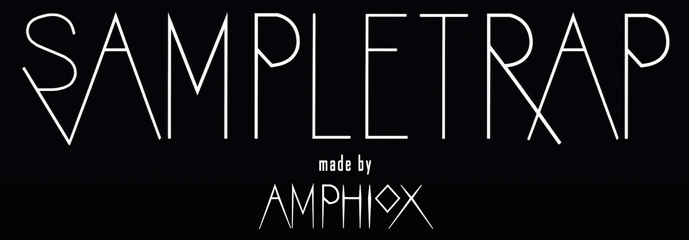

# SampleTrap

**[Download for Windows — 0.4.0 alpha](https://github.com/JesseManser/SampleTrap/releases/download/v0.4.0-alpha.1/SampleTrap-0.4.0-Windows-x64.zip)**

SampleTrap is a low-latency instant sampler VST3 designed for live performance at a 64-sample buffer.



**Status:** Alpha. Features and compatibility may change.

## Features

- 16 pads with up to 5 seconds of audio each
- Sample-accurate MIDI Note On/Off handling
- Per-pad MIDI Learn with saved assignments
- Hold-to-record functionality
- ONE SHOT and HOLD playback modes
- 32-sample fade to prevent clicks on release
- 16 automatable pad gates
- Optional input monitoring
- Zero reported plugin latency

Samples are stored in memory and are not yet saved with DAW sessions.

## Building

Requires CMake and a C++ build environment.

### macOS

```sh
cmake -S . -B build-debug -DCMAKE_BUILD_TYPE=Debug
cmake --build build-debug -j
```

### Windows

Requires Visual Studio 2022 with C++ support.

```powershell
cmake -S . -B build -G "Visual Studio 17 2022" -A x64
cmake --build build --config Release -j
```

Builds include VST3 and Standalone versions.

## MIDI Learn

Enable `MIDI LEARN`, select a pad, then press a MIDI note to assign it. Right-click a pad to clear its assignment.

MIDI must be routed directly to SampleTrap for Note Off handling to work correctly.

See `REQUIREMENTS.md` for technical details.

## Author

Jesse Manser / AMPHIOX

## Licence

GNU Affero General Public License v3.0 (`AGPL-3.0-only`).

Built with JUCE under its AGPLv3 licence. See `LICENSE` and `THIRD_PARTY_NOTICES.md`.
